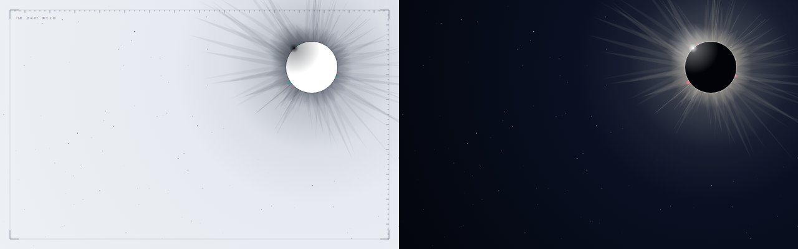
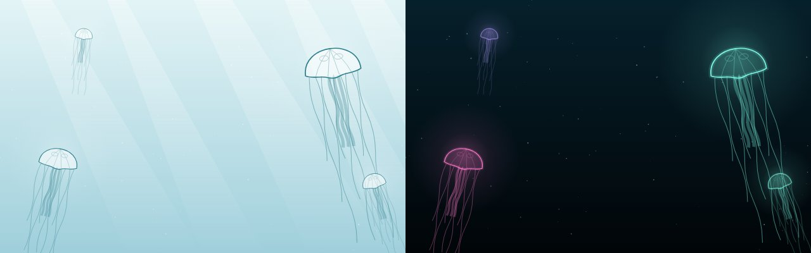
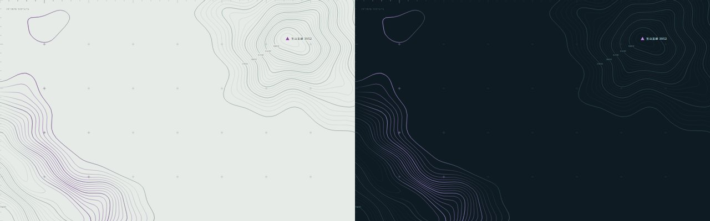
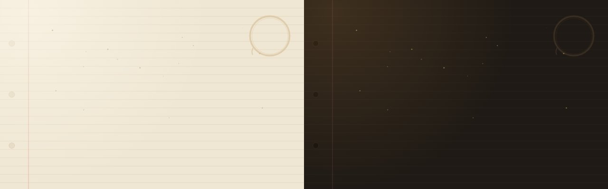
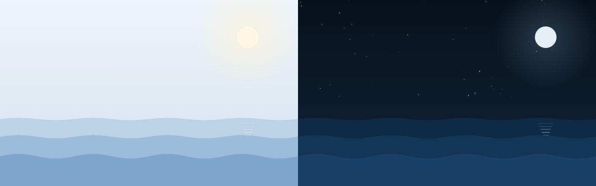
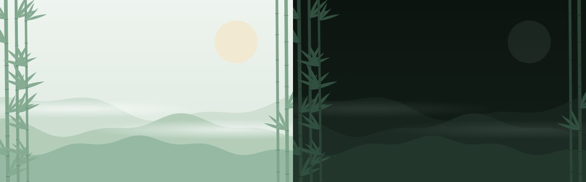
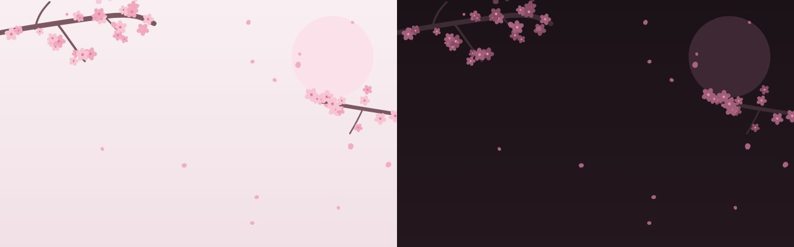
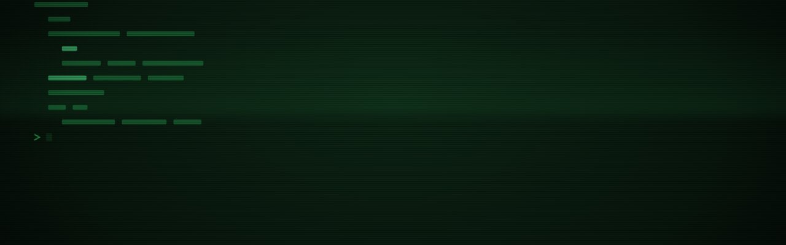

# cc-looks

Twelve looks for the Claude desktop and mobile apps, each a colour palette plus a background. Switch between them with `/look`.

## Gallery

Each animated background in light mode (left) and dark mode (right), paused at the moment its motion shows. The app picks the side that matches its own mode.

### `eclipse` (default)


### `deepsea`


### `survey`


### `paper`


### `ocean`


### `jade`


### `sakura`


### `phosphor` (one look for both modes)


## All looks

| Name | Background | Kind |
| --- | --- | --- |
| `paper` | Ruled notebook paper, coffee ring, dust drifting in lamp light | animated |
| `ocean` | Calm sea under the moon, stars at night, pale sun by day | animated |
| `jade` | Misty green hills with swaying bamboo | animated |
| `sakura` | Cherry blossom branches, petals drifting down | animated |
| `eclipse` | Total solar eclipse in the upper right; a photographic-plate negative by day, a soft gold corona at night (default) | animated |
| `deepsea` | Jellyfish drifting at the edges; sunbeams in the shallows by day, glowing in the deep at night | animated |
| `survey` | Topographic map of Yushan; a slow pulse spreads from the summit and lights each contour it crosses | animated |
| `phosphor` | Green-on-black terminal, scanlines, slow sweep (dark only) | animated |
| `dusk` | Gradient from the page colour into accent blue | still |
| `dots` | Dotted bullet-journal grid | still |
| `grid` | Graph-paper lines | still |
| `blush` | One flat blush colour | still |

The terminal and editor extensions don't draw themes, so a look only shows in the desktop and mobile apps.

## Install

At the prompt of a Claude Code terminal session:

```
/plugin install cc-looks --marketplace hank0521/cc-looks
```

Answer `y` to add the marketplace, then pick a scope (user is first; press Enter).

From a shell:

```
claude plugin install cc-looks --marketplace hank0521/cc-looks
```

In the Claude desktop app, where `/plugin` doesn't run: click + next to the prompt box, then Plugins, Add marketplace with `hank0521/cc-looks`, then Add plugin.

Once installed at the user scope, the mod loads in every new session, including the desktop app's Code tab, and starts on the `eclipse` look.

## Commands

- `/look` or `/look list` lists the looks and marks the current one.
- `/look <name>` switches to that look and remembers it for the next session.
- `/look off` goes back to the app's own look.

## Making your own

- **Change colours:** edit a palette in `hooks/looks.ts`. Each palette sets the page and card surfaces, three text shades and five role colours (accent, danger, success, warning, pro).
- **Change a scene:** edit an SVG in `scenes/`, then run `node tools/build-scenes.mjs`. It checks the SVG against the rules Claude Code holds backgrounds to, rewrites `hooks/scenes.ts` and refreshes `preview.html`.
- **Add a scene:** add `scenes/<name>.svg`, add an entry to `LOOKS` in `hooks/looks.ts` with `backdrop: { scene: '<name>' }`, then run the build.
- **Add a still background:** add an entry with `backdrop: { color }`, `{ gradient }` or `{ vector }`. These need no SVG file.

Scene rules: pure vector (no images, fonts or external links), at most 131,072 characters, slow motion only, and `@media (prefers-color-scheme: dark)` for the dark version. Keep the main subject near the edges, because the conversation covers the middle and the message box covers the bottom.

## Checking it

```
claude plugin validate .
claude plugin test .
```

Open `preview.html` in a browser to see every scene in light and dark mode.

## License

MIT. See [LICENSE](LICENSE).

`hooks/make-colors.js` and `hooks/make-colors.d.ts` are not part of this licence: they are the colour helper from Claude Code's mod-authoring kit, which asks mod authors to copy them into a mod's `hooks/` folder unchanged.
